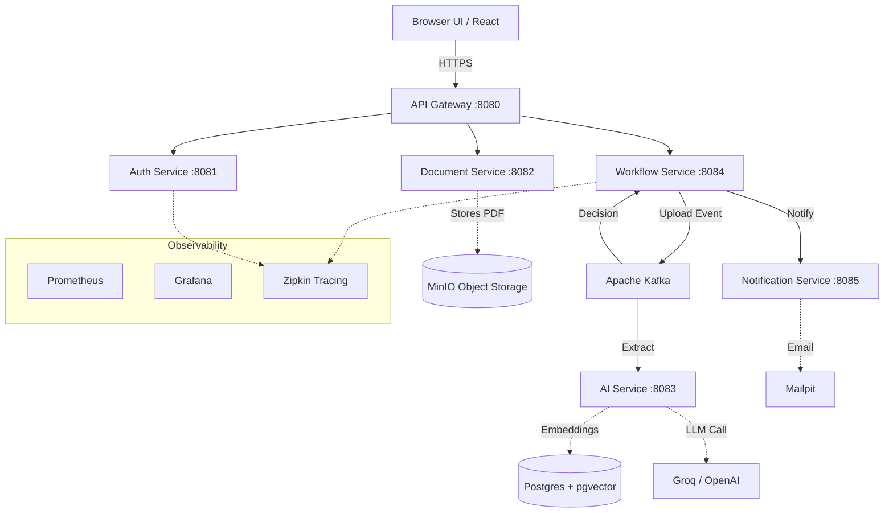

<div align="center">
  
  # ⚡ FinSight AI

  **Enterprise-Grade AI-Powered Financial Document Intelligence Platform**

  [](https://jdk.java.net/21/)
  [](https://spring.io/projects/spring-boot)
  [](https://react.dev/)
  [](https://kafka.apache.org/)
  [](https://github.com/pgvector/pgvector)
  [](https://www.docker.com/)
  [](https://opensource.org/licenses/MIT)
</div>

<br/>

> **FinSight AI** automates the end-to-end processing of complex financial documents (like loan applications). By leveraging modern AI extraction techniques, robust event-driven microservices, and enterprise compliance rules, it transforms unstructured PDFs into structured, actionable intelligence—in seconds.

---

## 🎯 Executive Summary (Easy to Explain)

**What does this project do?**
FinSight AI is a system that reads uploaded financial documents (like PDFs) and automatically extracts the important data from them using AI. 

**How does it work end-to-end?**
1. **Upload:** A user logs into the web interface and uploads a document.
2. **Store:** The system safely saves the document.
3. **Analyze:** The AI reads the document, understands it, and extracts the key information (like names, amounts, and dates).
4. **Decide:** A workflow engine checks the extracted data and decides what to do next.
5. **Notify:** The system sends an email to notify you that the processing is complete.

Behind the scenes, we use small, independent programs (called microservices) that talk to each other to handle these steps efficiently.

---

## ✨ Key Features

- 🧠 **AI-Powered Data Extraction:** Utilizes **Spring AI** and Groq/OpenAI to reliably parse structured data from unstructured financial PDFs.
- 🚀 **Event-Driven Architecture:** Highly scalable, decoupled microservices orchestrated via **Apache Kafka**.
- 🛡️ **Enterprise Security & Compliance:** Built-in JWT authentication, role-based access, and automated compliance validation checks.
- 📊 **Comprehensive Observability:** Fully instrumented with **Micrometer, Zipkin, Prometheus, and Grafana** for deep tracing and monitoring.
- ⚡ **Resilient Processing:** Designed for failure with **Resilience4j** circuit breakers, retry mechanisms, and Dead Letter Queues (DLQ).
- 💻 **Modern UI/UX:** A sleek, responsive React 18 SPA utilizing Tailwind CSS and Vite, featuring dark mode and glassmorphism design patterns.

---

## 🏗️ Architecture

FinSight AI employs a modern, loosely-coupled microservices pattern. 



For an in-depth dive into the system design, check out our [Architecture Guide](./ARCHITECTURE.md).

---

## 🛠️ Technology Stack Used

| Category | Technologies |
| :--- | :--- |
| **Backend Core** | Java 21, Spring Boot 3.5, Spring Cloud (Gateway, Config, Eureka) |
| **AI & Data** | Spring AI, PostgreSQL 16, pgvector, Flyway |
| **Messaging & Storage** | Apache Kafka, Redis, MinIO (S3-compatible) |
| **Security & Resiliency** | Spring Security, JWT, Resilience4j |
| **Observability** | Micrometer, Zipkin, Prometheus, Grafana |
| **Frontend** | React 18, Vite, Tailwind CSS, Recharts, Axios |
| **DevOps & Infrastructure** | Docker, Docker Compose, GitHub Actions |

---

## 🚀 Getting Started

### Prerequisites

You only need two things installed locally to run the entire stack:
1. **Docker** (v24+) & **Docker Compose** (v2+)
2. **Groq API Key** (Get one for free at [console.groq.com](https://console.groq.com))

> **Note:** You do **not** need Java, Node.js, or Maven installed locally to run the platform! Everything is containerized.

### Quick Start (Local Deployment)

**1. Clone the repository:**
```bash
git clone https://github.com/Rajathacharya24/FinSight-AI.git
cd FinSight-AI
```

**2. Configure your Environment:**
```bash
cp .env.example .env
```
Open `.env` and set your secure variables:
```env
# Generate a secure JWT secret
JWT_SECRET=$(openssl rand -base64 48 | tr -d '\n')

# Paste your Groq API key here
GROQ_API_KEY=gsk_your_actual_key_here
```

**3. Fire it up!** 🚀
```bash
# This builds 8 Java microservices, the React app, and starts all infra databases
docker compose up --build -d
```
*(Grab a coffee ☕ — the first build takes 5-10 minutes to resolve Maven dependencies. Subsequent starts are lightning fast!)*

**4. Verify Health:**
```bash
# Check if API gateway is routing
curl http://localhost:8080/actuator/health
```

### 🎯 Access the Platform

Once healthy, explore the FinSight AI ecosystem:

| Service | URL | Default Credentials |
| :--- | :--- | :--- |
| **FinSight Web UI** | [http://localhost:3000](http://localhost:3000) | `demo` / `demo123` |
| **API Gateway** | `http://localhost:8080` | N/A |
| **Eureka Registry** | `http://localhost:8761` | N/A |
| **Grafana Dashboards** | `http://localhost:3001` | `admin` / `admin` |
| **Zipkin Tracing** | `http://localhost:9411` | N/A |
| **MinIO Console** | `http://localhost:9001` | `minioadmin` / `minioadmin` |
| **Mailpit (Emails)** | `http://localhost:8025` | N/A |

For detailed deployment strategies (including CI/CD and Production hardening), see the [Deployment Guide](./DEPLOYMENT.md).

---

## 📖 API Usage Example

FinSight AI provides a rich RESTful API. Here is a quick example of authenticating and submitting a document for processing.

**1. Authenticate & Get JWT**
```bash
curl -X POST http://localhost:8080/api/v1/auth/login \
  -H 'Content-Type: application/json' \
  -d '{"username":"demo","password":"demo123"}'
  
# Extract the token from the response
TOKEN="Bearer <your-jwt-token>"
```

**2. Process a Loan Application**
```bash
curl -X POST http://localhost:8080/api/v1/workflows \
  -H "Authorization: $TOKEN" \
  -F 'metadata={"title":"Mortgage Application","description":"John Doe"};type=application/json' \
  -F 'file=@/path/to/loan-document.pdf;type=application/pdf'
```

---

## 📂 Repository Structure

The monorepo is thoughtfully structured by domain context:

```text
FinSight-AI/
├── api-gateway/           # Edge routing, CORS, JWT validation
├── auth-service/          # Identity provider, RBAC, Redis rate-limiting
├── document-service/      # Ingestion, OCR, PDFBox, MinIO persistence
├── ai-service/            # Spring AI, pgvector RAG, LLM integration
├── workflow-service/      # Kafka orchestration, state machine, circuit breakers
├── notification-service/  # Async alerts, webhooks, SMTP/Mailpit
├── config-server/         # Distributed Git-backed configuration
├── discovery-server/      # Netflix Eureka service registry
├── frontend/              # React 18, Vite, Tailwind CSS SPA
├── infra/                 # Grafana dashboards, Prometheus configs, scripts
└── docker-compose.yml     # Local orchestration manifest
```

---

## 🤝 Contributing

We welcome contributions from the community! Whether you are fixing a bug, enhancing AI capabilities, or improving documentation, your help is appreciated.

Please review our [Contributing Guidelines](./CONTRIBUTING.md) to understand our:
- Local Development Setup (Running services bare-metal)
- Branching Strategy (`feat/*`, `fix/*`, `chore/*`)
- Conventional Commits requirement
- Pull Request Workflow

---

## 🛡️ Security Vulnerabilities

If you discover a security vulnerability within FinSight AI, please refer to our [Security Policy](./SECURITY.md) and disclose it responsibly.

---

## 📄 License

Distributed under the **MIT License**. See `LICENSE` for more information.

<p align="center">
  Built with ❤️ by the FinSight AI Open Source Community.
</p>
