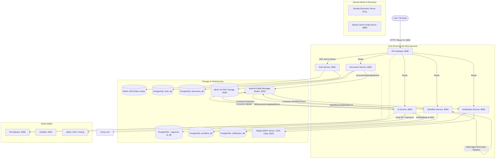

# FinSight AI — Enterprise Financial Document Intelligence Platform

**FinSight AI** is a production-grade, event-driven microservices platform built with Java 21, Spring Boot 3.4, Spring Cloud, Apache Kafka, Spring AI, PostgreSQL (with pgvector), MinIO, Redis, and React 18.

---

## 🏛 System Architecture



---

## 🚀 Microservices Breakdown

1. **`discovery-server` (Port 8761)**: Eureka service registry & discovery.
2. **`config-server` (Port 8888)**: Spring Cloud Config Server providing centralized environment configurations.
3. **`api-gateway` (Port 8080)**: Spring Cloud Gateway with reactive JWT authentication filtering, CORS configuration, correlation ID propagation, and dynamic routing.
4. **`auth-service` (Port 8081)**: User registration, login, BCrypt password encoding, JWT token generation, refresh tokens, and Redis-backed login rate-limiting.
5. **`document-service` (Port 8082)**: PDF file upload validation, MinIO object storage, Apache PDFBox raw text extraction, and publishing `DocumentUploadedEvent` to Kafka.
6. **`ai-service` (Port 8083)**: Groq LLM structured extraction (`borrowerName`, `loanAmount`, `annualIncome`, `applicationDate`, `loanPurpose`, `employmentStatus`, `confidenceScore`), pgvector text chunk embeddings, and RAG document search endpoint (`POST /api/v1/ai/documents/{id}/query`).
7. **`workflow-service` (Port 8084)**: Multi-Agent underwriting execution pipeline (`DocumentAnalyzerAgent` → `ComplianceAgent` → `DecisionAgent`), state transitions (`APPROVED`, `REJECTED`, `NEEDS_REVIEW`), audit trail persistence, manual review override, and analytics endpoints.
8. **`notification-service` (Port 8085)**: Consumes workflow completion events, generates HTML email notifications, dispatches emails to Mailpit SMTP, and records notification logs.
9. **`frontend` (Port 3000)**: Enterprise React 18 dashboard built with Vite, Tailwind CSS, Axios, and Recharts.

---

## 🔑 Demo Account Credentials

| Account | Username | Password | Role |
| :--- | :--- | :--- | :--- |
| Demo User | `demo` | `demo123` | `USER` |

---

## 💻 Quick Start with Docker Compose

### Prerequisites
- Docker & Docker Compose
- Maven (optional for manual jar packaging)

### Launch Entire Platform
```bash
# 1. Clone repository
git clone https://github.com/Rajathacharya24/FinSight-AI.git
cd FinSight-AI

# 2. Build Java microservices
mvn clean package -DskipTests

# 3. Build & launch Docker containers
docker compose up --build -d
```

### Access Platform Endpoints
- **React Frontend**: `http://localhost:3000`
- **API Gateway**: `http://localhost:8080`
- **Eureka Dashboard**: `http://localhost:8761`
- **Mailpit Email UI**: `http://localhost:8025`
- **MinIO Console**: `http://localhost:9001` (user: `minioadmin` / pass: `minioadmin`)
- **Prometheus**: `http://localhost:9090`
- **Grafana**: `http://localhost:3000`
- **Zipkin Tracing**: `http://localhost:9411`

---

## ⚡ Asynchronous Event Flow

```text
User PDF Upload
     ↓
Document Service (Stores in MinIO & Postgres)
     ↓ (Publishes DocumentUploadedEvent)
Kafka Topic: document-uploaded-topic
     ↓
AI Service (Parses JSON DTO via Groq + Stores Chunks in pgvector)
     ↓ (Publishes AIExtractionCompletedEvent)
Kafka Topic: ai-extraction-completed-topic
     ↓
Workflow Service (Executes 3-Agent Compliance Pipeline & Audit Log)
     ↓ (Publishes WorkflowCompletedEvent)
Kafka Topic: workflow-completed-topic
     ↓
Notification Service (Renders HTML Email & Sends to Mailpit SMTP)
```

---

## 🔍 Retrieval-Augmented Generation (RAG) Architecture

`ai-service` implements RAG for semantic financial document Q&A:
1. **Text Chunking**: PDF text is partitioned into overlapping semantic chunks.
2. **Vector Storage**: Text chunks and vector embeddings are stored in PostgreSQL using the `pgvector` extension.
3. **Query Retrieval**: When a user queries `/api/v1/ai/documents/{documentId}/query`, the top relevant context chunks are fetched via vector similarity.
4. **Contextual LLM Generation**: The retrieved context and question are formatted into an augmented prompt sent to Groq / Spring AI ChatModel.

---

## 🧪 Testing

```bash
# Run unit & integration tests
mvn test
```

---

## 🛡 Security & Resilience

- JWT stateless authentication enforced across API Gateway routes.
- BCrypt password hashing for stored credentials.
- Redis key expiration rate-limiting against brute force logins.
- Resilience4j circuit breaking and timeouts on synchronous service calls.
