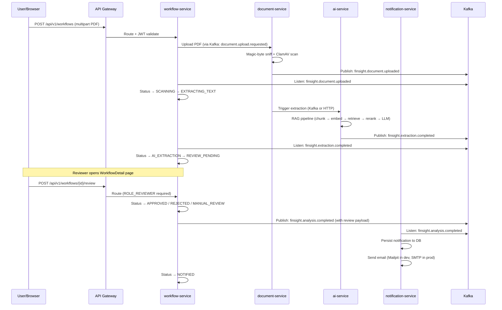

# FinSight-AI — Architecture

## System Overview

FinSight-AI is a financial document intelligence platform that processes loan applications using AI-powered extraction, compliance checking, and human-in-the-loop review.

```
Browser → nginx → API Gateway (:8080)
                        │
    ┌───────────────────┼─────────────────────┐
    ▼                   ▼                     ▼
auth-service      document-service        ai-service
   (:8081)            (:8082)               (:8083)
                                              │
                                       workflow-service
                                           (:8084)
                                              │
                                   notification-service (:8085)

Infrastructure:
  PostgreSQL + pgvector │ Redis │ Kafka │ Eureka │ Config Server │ Zipkin │ MinIO │ Mailpit
```

## Upload → Review → Notify Flow



## Kafka Topics

| Topic | Producer | Consumer(s) | Description |
|-------|---------|-------------|-------------|
| `finsight.document.uploaded` | document-service | workflow-service, notification-service | Document uploaded + scanned successfully |
| `finsight.extraction.completed` | ai-service | workflow-service, notification-service | LLM extraction finished |
| `finsight.analysis.completed` | workflow-service | notification-service | Review decision recorded |
| `*.dlt` (dead-letter topics) | Kafka retry mechanism | workflow-service-dlt consumer | Failed events after 4 retry attempts |

## Service Ports

| Service | Port | Notes |
|---------|------|-------|
| API Gateway | 8080 | Public entry point |
| auth-service | 8081 | JWT issue, refresh, revoke |
| document-service | 8082 | PDF upload, storage (MinIO), text extraction |
| ai-service | 8083 | RAG pipeline, LLM extraction, Q&A |
| workflow-service | 8084 | State machine, review, audit log |
| notification-service | 8085 | Email, webhook, in-app history |
| Eureka | 8761 | Service discovery |
| Config Server | 8888 | Centralised config |
| Kafka UI | 8090 | Topic/consumer lag monitoring |
| Mailpit (SMTP) | 1025 | Dev email capture |
| Mailpit (Web UI) | 8025 | View sent emails |
| MinIO API | 9000 | Object storage |
| MinIO Console | 9001 | MinIO management UI |
| Prometheus | 9090 | Metrics |
| Zipkin | 9411 | Distributed tracing |
| Grafana | 3001 | Dashboards |
| Frontend | 3000 | React SPA |

## Data Flow for AI Extraction

```
PDF bytes
   │
   ▼ PDFBox text extraction
Raw text (may be empty for scanned PDFs → NEEDS_OCR)
   │
   ▼ TokenTextSplitter (Spring AI)
Document chunks (~500 tokens each)
   │
   ▼ Embedding model (text-embedding-3-small / nomic-embed-text)
Float[1536] vectors → pgvector store
   │
   ▼ Similarity search: top-8 chunks matching loan field keywords
Candidate chunks
   │
   ▼ LLM reranking: score each chunk 0-100 for relevance
Top-3 reranked chunks
   │
   ▼ Extraction prompt (user-message only — guardrail against injection)
LLM response (JSON)
   │
   ▼ Schema validation (all required fields present?)
       ├── Valid → parse fields
       └── Invalid → corrective prompt retry → parse or empty result
   │
   ▼ Per-field confidence scoring (retrieval quality × parse success)
ExtractionResult with confidenceScore + fieldConfidenceScores map
   │
   ▼ Persist to loan_application_extraction table
   ▼ Return ExtractionResponse to workflow-service
```

## Database Schema Overview

Each service owns its own Flyway-managed schema within the shared `finsight_db` database.

| Service | Tables |
|---------|--------|
| auth-service | `users`, `refresh_tokens` |
| document-service | `documents` |
| ai-service | `loan_application_extraction`, `document_embedding` (pgvector) |
| workflow-service | `workflow_instances`, `workflow_audit_logs` |
| notification-service | `notifications` |
